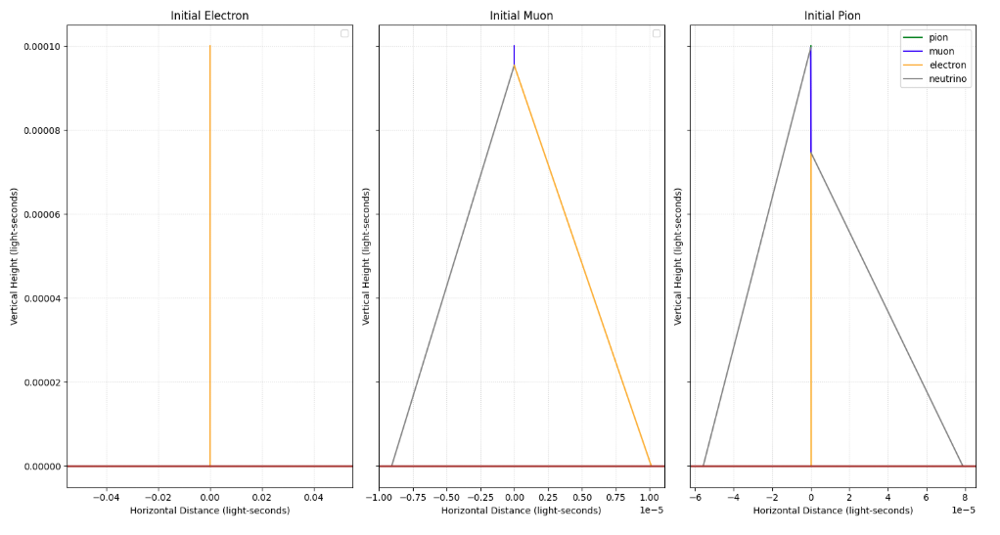

# Atmospheric Cosmic Ray Shower Monte Carlo Simulation

A Monte Carlo simulation modeling the atmospheric decay, downscattering, and attenuation of relativistic cosmic ray particles. This project was originally developed as part of the PHYS 2600 coursework at the University of Colorado Boulder.

## Overview

When high-energy galactic protons enter the upper atmosphere (approximately 20 km above the surface), they collide with atmospheric nuclei (such as Nitrogen-14), initiating a cascade of hadronic and leptonic particle interactions. This simulation tracks the generation, trajectory, and decay of these particles down to the Earth's surface.

### Core Physics Concepts Modeled
* **Relativistic Kinematics:** Computes Lorentz factors ($\beta$, $\gamma$) and transforms momentum vectors between rest frames and the laboratory frame using relativistic boosts.
* **Particle Decay Chains:** Simulates the stochastic two-body decay of unstable particles, such as pions decaying into muons and neutrinos ($\pi \rightarrow \mu + \nu$), and muons decaying into electrons and neutrinos ($\mu \rightarrow e + \nu$).
* **Hadronic Downscattering:** Models inelastic proton-nitrogen collisions producing multi-pion showers ($p \rightarrow p + \pi + \pi$) while conserving relativistic energy and momentum.
* **Time Dilation:** Demonstrates the necessity of special relativity by comparing classical vs. relativistic muon survival rates through the atmosphere.

## Visualizations and Results

### 1. Basic Particle Decay Profiles
The simulation models the trajectories and decay characteristics of individual particles over time. Electrons do not decay in this model and fall directly to the ground, whereas pions exhibit complex decay chains into muons and neutrinos. Conservation of momentum is visually observable as decay products diverge with equal and opposite horizontal momenta.

